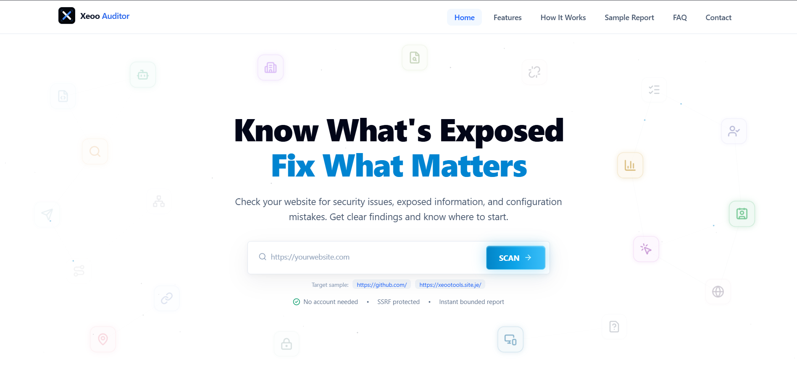
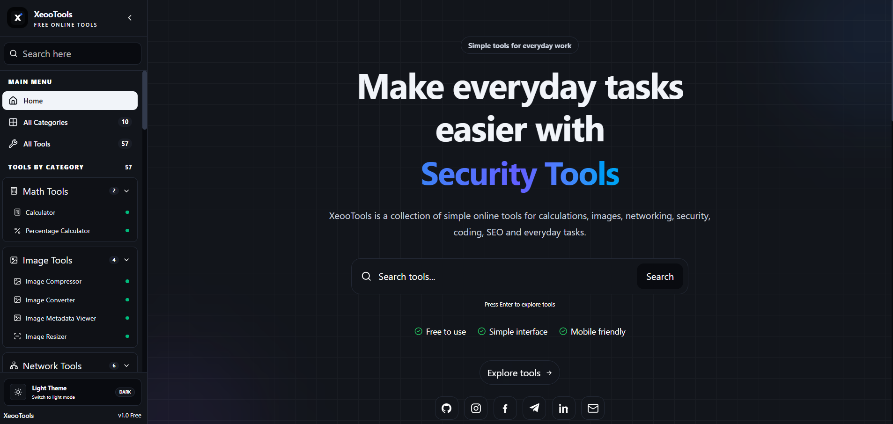
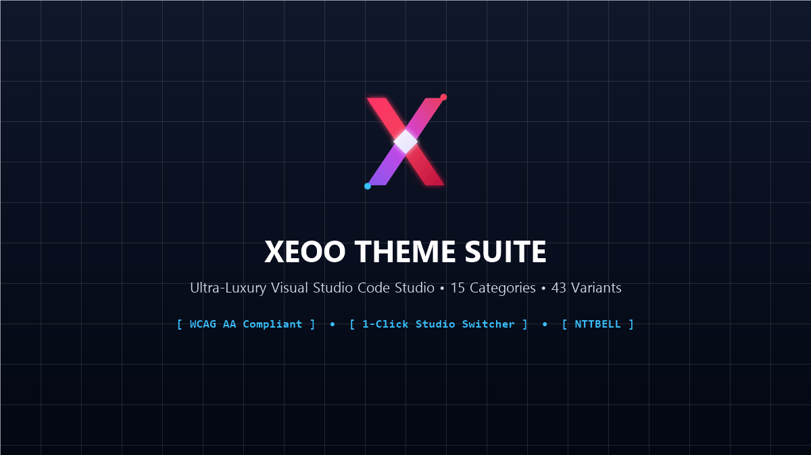
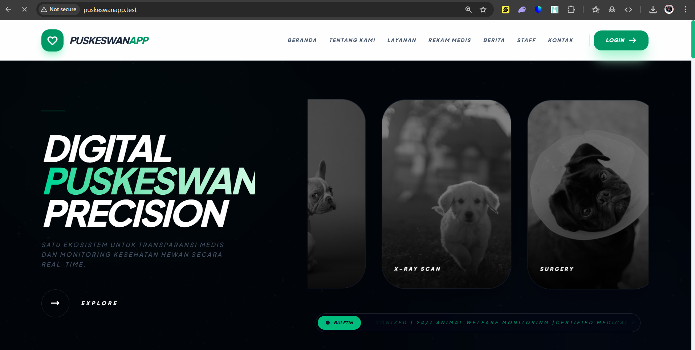

# 🪐 Developer — Abbel

  
  
  

---

## 🛠️ Technology Stack

<b>1. 💻 Programming Languages & Web</b>

 

| Technology | Role & Functional Specialization | Badge |
| :--- | :--- | :---: |
| **TypeScript** | Static Typing & Scalable Web Apps | `TS` |
| **JavaScript** | Dynamic Client Logic & DOM Scripting | `JS` |
| **PHP** | Server-Side Scripting & REST API Logic | `PHP` |
| **Python** | Automation Scripts, Tooling & Backend | `PY` |
| **Lua / Luau** | Roblox Game Development & Scripting | `LUA` |
| **HTML5** | Semantic Web Structure & Document Markup | `HTML` |
| **CSS3** | Responsive Layouts, Grid & UI Styling | `CSS` |

<b>2. ⚡ Framework, Library & Development Tools</b>

 

| Technology | Role & Functional Specialization | Badge |
| :--- | :--- | :---: |
| **React** | Component-Based UI & Single Page Apps | `React` |
| **Laravel** | Fullstack PHP MVC & Secure Web Backend | `Lara` |
| **Node.js** | Server-Side JS Runtime & CLI Tooling | `Node` |
| **Vite** | Fast Modern Bundler & HMR Dev Server | `Vite` |
| **Tailwind CSS** | Utility-First CSS & Rapid Design Systems | `TW` |
| **Bootstrap** | Responsive UI Components & 12-Col Grid | `BS` |

<b>3. 🗄️ Database & Backend Services</b>

 

| Technology | Role & Functional Specialization | Badge |
| :--- | :--- | :---: |
| **MySQLi** | Relational SQL Storage & Prepared Queries | `SQL` |
| **PostgreSQL** | Enterprise Relational DB & Complex Data | `PG` |
| **Supabase** | Cloud BaaS & Realtime PostgreSQL DB | `Supa` |

<b>4. 🚀 Deployment & Version Control</b>

 

| Technology | Role & Functional Specialization | Badge |
| :--- | :--- | :---: |
| **Vercel** | Serverless Frontend & Edge Cloud CI/CD | `▲` |
| **Git** | Version Control | `Git` |
| **GitHub** | Code Repository Hosting | `GH` |
| **Wuaze** | PHP Web Hosting | `Wz` |

<b>5. 🌟 Specialized Project Competencies & Office Productivity</b>

 

| Competency | Domain Expertise & Applied Toolkits | Application |
| :--- | :--- | :---: |
| **Microsoft Office Suite** | Word, Excel & PowerPoint for technical documentation, data analysis & reporting | `MS 365` |
| **Leaflet JS & Web GIS** | Open-source geospatial mapping, GeoJSON boundary layers & public amenity markers | `GIS / MAP` |
| **VS Code API & Extensions** | Native editor extension architecture, Webview companion panels & WCAG AA theme suites | `VS CODE` |
| **Chrome Extension API (MV3)** | Manifest V3 service workers, DOM MutationObserver shields & client privacy | `MANIFEST V3` |
| **Web Security & Auditing** | SSRF boundary firewalls, SSL/TLS inspection, HTTP security headers & defacement CTF | `SECURITY` |
| **UI/UX Design Systems** | High-contrast dark aesthetics, ergonomic responsive components & WCAG AA standards | `WCAG AA` |

---

## 🚀 Featured Projects

<h3>1. 🛡️ Xeoo Auditor</h3>

> **Category:** Cyber Security & Audit  
> **Client / Target:** Open Source / Security Community  
> **Links:** [🌐 Live Application](https://xeooauditor.xo.je/) • [🐙 GitHub Repository](https://github.com/notbell1/xeoo-auditor)

Automated web security diagnostics and technical visibility platform with zero-PII ephemeral retention. Features a server-side SSRF boundary firewall and comprehensive multi-vector auditing covering SSL/TLS hygiene, security headers, server latency, and SEO crawlability.

* **Tech Stack:** `React 19` • `TypeScript` • `Tailwind CSS v4` • `PHP 8.x` • `MySQL` • `Vite`
* **Key Deliverables:**
  - SSRF Boundary Firewall blocking internal subnet scanning, RFC1918 ranges, and cloud metadata endpoints.
  - 5-Pillar Audit Engine scanning SSL/TLS, HTTP headers (HSTS, CSP), Server Latency, SEO, and Privacy trackers.
  - Ephemeral data retention ensuring zero personal user telemetry or persistent audit logs.
  - Executive reporting with instant high-fidelity PDF and structured JSON export.

<h3>2. 🧰 Xeoo Tools</h3>

> **Category:** Developer Tools & CTF  
> **Client / Target:** Independent Developer Platform  
> **Links:** [🌐 Live Application](https://xeootools.site.je/) • [🐙 GitHub Repository](https://github.com/notbell1/xeoo-tools)

A multi-suite web utility ecosystem featuring over 30+ interactive developer tools, client-side media laboratories, and an isolated Defacement CTF (Capture The Flag) cyber platform with server-authoritative flag verification.

* **Tech Stack:** `React` • `TypeScript` • `Tailwind CSS` • `Vite` • `PHP` • `MySQL`
* **Key Deliverables:**
  - Defacement CTF Subsystem with dynamic leaderboard, challenge management, and anti-tamper scoring.
  - Client-side image and media optimization engine (WebP/PNG/AVIF converter, lossless compressor, archive builder).
  - Cyber security toolset: Password strength analyzer, scam link detector, JWT debugger, and hash identifiers.
  - Interactive productivity modules including typing speed tests and QR code generators.

<h3>3. 🪐 3D Solar System Portfolio</h3>

> **Category:** Interactive 3D Web & Creative Portfolio  
> **Client / Target:** Personal Production Portfolio  
> **Links:** [🌐 Live Application](https://nottbell.vercel.app/) • [🐙 GitHub Repository](https://github.com/notbell1/portfolio)

An interactive 3D solar system developer portfolio engineering experience. Features dynamic multi-layered celestial orbits, real-time trigonometric coordinate calculations, CV download modal, and smooth Framer Motion interactions.

* **Tech Stack:** `React 19` • `TypeScript` • `Tailwind CSS v4` • `Vite` • `Framer Motion`
* **Key Deliverables:**
  - 6-Layer responsive orbital dynamics with trigonometrically computed satellite nodes.
  - Interactive CV download modal popup and ambient cosmic audio player.
  - Ergonomic mobile-first responsive design adapting seamless layouts across viewport sizes.

<h3>4. 🎨 Xeoo Theme Suite</h3>

> **Category:** VS Code Extension  
> **Client / Target:** Visual Studio Code Marketplace / NTTBELL  
> **Links:** [🐙 GitHub Repository](https://github.com/notbell1/zx-theme)

An ultra-luxury, ergonomically balanced Visual Studio Code color theme suite featuring 15 primary color categories and 43 calibrated variants (Dark, Soft, Light) with distinct interface zone elevation and 1-Click Studio Switcher.

* **Tech Stack:** `TypeScript` • `VS Code API` • `Node.js` • `WCAG AA`
* **Key Deliverables:**
  - 43 calibrated theme variants across 15 primary color families with WCAG AA compliance (4.5:1 ~ 14:1 contrast).
  - Complete interface elevation redesign distinguishing Title Bar, Sidebar, Editor canvas, and Status Bar.
  - Integrated 1-Click Theme Switcher sidebar view container built natively with VS Code APIs.
  - 100% safe, lightweight architecture with zero third-party telemetry.

<h3>5. 🩺 Core Vitality</h3>

> **Category:** Developer Experience  
> **Client / Target:** Open Source / VS Code Community  
> **Links:** [🐙 GitHub Repository](https://github.com/notbell1/core-vitality)

Realtime developer health tracker and error diagnostics dashboard embedded in Visual Studio Code. Features a living, dynamic evolving SVG companion responding to code quality, health metrics, and instant error incident logs.

* **Tech Stack:** `TypeScript` • `VS Code API` • `SVG Animation` • `Webview API`
* **Key Deliverables:**
  - Dynamic interactive SVG avatar that evolves and reacts based on Health, Energy, and Happiness vitals.
  - Real-time incident detection capturing runtime errors with exact file location (LOC) and line numbers (LINE).
  - Nebula Glassmorphism interface aesthetic with integrated hacker-style focus clock.
  - Lightweight webview integration running locally with zero performance overhead on the editor.

<h3>6. 🛡️ Nttbell Assistant</h3>

> **Category:** Browser Extension  
> **Client / Target:** Chrome Web Store / NTTBELL  
> **Links:** [🐙 GitHub Repository](https://github.com/notbell1/nttbell-assistant)

Next-generation visual privacy and anti-shoulder surfing shield for WhatsApp Web. Automatically masks sensitive chats, contact identities, and incoming media with smart blur and instant hover-to-reveal capability.

* **Tech Stack:** `TypeScript` • `Vite` • `Chrome Extension API` • `Manifest V3`
* **Key Deliverables:**
  - Granular privacy shields covering chat message streams, contact identities, and multimedia previews.
  - Realtime MutationObserver engine maintaining blur integrity across dynamic chat updates.
  - Smooth hover-to-reveal effect allowing temporary inspection of masked messages.
  - 100% local client-side processing under Chrome Manifest V3 with zero external network requests.

<h3>7. 🗺️ Mapping of Regional Potential in Balai Gadang 2026</h3>

> **Category:** Web GIS & Regional Mapping  
> **Client / Target:** Balai Gadang Village Office, Padang City  
> **Links:** [🌐 Live Application](https://balai-gadang.vercel.app/) • [🐙 GitHub Repository](https://github.com/notbell1/balai-gadang)

Regional potential mapping and interactive Web Geographic Information System (Web GIS) developed for Balai Gadang Village, Koto Tangah, Padang City. Integrates spatial mapping of 80+ public facilities, 25+ local economic and agrotourism potentials, administrative RW boundaries, and open neighborhood demographic statistics.

* **Tech Stack:** `React 19` • `Leaflet JS` • `Tailwind CSS v4` • `Vite` • `GeoJSON` • `MS Excel`
* **Key Deliverables:**
  - Interactive Leaflet JS and GeoJSON mapping of 81+ public facilities (health, religious, education, and municipal).
  - Geospatial showcase of 25+ superior regional potentials, ornamental plant centers, and local MSME enterprises.
  - Demographic dashboard charting 20,000+ residents across 14 RW (Neighborhood Units) and 38 RT divisions.
  - Modern open digital system with responsive layout built on React 19 and Tailwind CSS v4.

<h3>8. 📖 Balai Gadang KKN Logbook 2026</h3>

> **Category:** Community Service & Web App  
> **Client / Target:** UISB University Community Service Team (KKN)  
> **Links:** [🌐 Live Application](https://kkn-uisb-balaigadang.vercel.app/) • [🐙 GitHub Repository](https://github.com/notbell1/kkn-uisb-balaigadang)

Digital logbook and community documentation portal engineered for the UISB University Community Service (KKN) program in Balai Gadang Village, Koto Tangah, Padang City. Features daily field activity tracking, work program timeline execution, multimedia photo storytelling, and organizational member rosters.

* **Tech Stack:** `React 19` • `Tailwind CSS` • `Vite` • `Framer Motion` • `MS Office`
* **Key Deliverables:**
  - Interactive daily field activity logbook tracking work program milestones and operational dates.
  - Multimedia story and documentation gallery preserving community engagement memories.
  - Organizational structural matrix detailing student committees, field supervisors, and village stakeholders.
  - High-performance responsive interface built with React 19, Vite, and smooth Framer Motion interactions.

<h3>9. 🐾 Puskeswan Apps</h3>

> **Category:** Fullstack Web App  
> **Client / Target:** UPT Puskeswan & IB Pariaman City / Diskominfo  
> **Links:** *Municipal Internal Veterinary System*

Digital transformation of manual veterinary health records into an integrated web-based information system, enhancing operational efficiency and public service delivery for municipal animal clinics.

* **Tech Stack:** `Laravel 12` • `MySQL` • `Alpine JS` • `Tailwind CSS`
* **Key Deliverables:**
  - Integrated Digital Medical Record system with centralized database storage.
  - Complete animal owner profile management and vaccination history tracking.
  - Automated reporting system fulfilling regulatory and administrative workflows.
  - Responsive interface optimized for field veterinary officers on mobile and tablet devices.

---

## 📄 License

This project is open-source and licensed under the [MIT License](./LICENSE).

Copyright &copy; 2026 **Abbel (notbell1)**.
